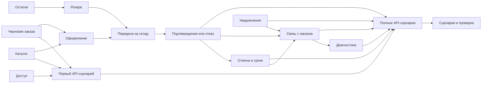

# Декомпозиция разработки API-бэкенда демонстрационного мини-магазина

Статус: план задач, обновлён 16 октября 2026 года. Основание:
[бизнес-анализ](demo-shop-business-analysis.md) и
[системный анализ](demo-shop-system-analysis.md). Этот документ фиксирует
порядок и проверяемый результат каждой задачи. Он не запускает реализацию.

## Цель и ограничения

Нужно получить работающий сценарий «витрина → корзина → оформление → резерв
всех позиций или отказ → отмена/истечение срока → локальное уведомление»,
показывающий работу внутри контекста и между контекстами. Каждый этап ниже
заканчивается проверяемым состоянием приложения. Обозначения `T01`–`T15`
стабильны для обсуждения задач и проверки покрытия требований.

- Результат — только JSON API-бэкенд. Веб-страницы, HTML/CSS/JavaScript,
  фронтенд, административный UI и браузерные тесты не входят в план.
  Сценарии выполняются HTTP-клиентом (например, `curl`) и проверяются
  функциональными и интеграционными тестами. Витрина и корзина здесь
  обозначают данные каталога и черновика заказа, доступные через API.
- Сохраняется сессионная аутентификация с CSRF-защитой. HTTP-клиент хранит
  cookie в отдельном cookie jar для каждого пользователя и передаёт
  `X-CSRF-Token` в запросах на изменение состояния.
- PHP >= 8.4.17, Symfony 8, Doctrine ORM 3, PostgreSQL 16; существующие
  `command.bus`, `query.bus`, `inbox.bus`, `outbox.bus` и Scheduler.
- Бизнес-модули: `Catalog`, `Ordering`, `Inventory`, `Notifications`.
  `Ordering` зависит только от опубликованных Contracts соседей через свои
  адаптеры в `Infrastructure/Integration`.
- Для каждого нового модуля нужны `AGENTS.md` по шаблону, конфигурация,
  регистрация в `Kernel::moduleDirectories()` и своя схема БД.
- Миграции и их применение, подготовка тестовой БД, новые зависимости и
  изменения окружения требуют отдельного согласования перед выполнением,
  как установлено корневым `AGENTS.md`. Декомпозиция такого согласования не
  заменяет. Автоматические коммиты не предусмотрены.
- Начальные товары и остатки создаются отдельными идемпотентными командами
  владельцев в dev/demo окружении; тестовые fixtures остаются только в `tests`.
  Каталог и склад используют заранее согласованные `productId` без FK.

## Карта файлов

| Область | Ожидаемое расположение |
| --- | --- |
| Общий вход и безопасность | `config/packages/security.yaml`, `config/routes/security.yaml`, технический HTTP-адаптер в `src/Shared/Presentation/Http/` |
| Витрина | `src/Catalog/{Domain,Application,Contracts,Presentation,Infrastructure,config}/`, тесты `tests/{Unit,Integration,Functional}/Catalog/` |
| Заказы | `src/Ordering/{Domain,Application,Presentation,Infrastructure,config}/`, межмодульные адаптеры в `src/Ordering/Infrastructure/Integration/`, тесты `tests/{Unit,Integration,Functional}/Ordering/` |
| Склад | `src/Inventory/{Domain,Application,Contracts,Presentation,Infrastructure,config}/`, тесты `tests/{Unit,Integration,Functional}/Inventory/` |
| Уведомления | `src/Notifications/{Domain,Application,Contracts,Presentation,Infrastructure,config}/`, тесты `tests/{Unit,Integration,Functional}/Notifications/` |
| HTTP API | `src/<Module>/Presentation/Http/`; в `public/` остаётся точка входа Symfony |
| Команда запуска демо-данных | `Makefile` — только последовательный вызов команд владельцев |
| Документация запуска | `docs/demo-shop-demo.md` |
| Описание HTTP API и примеры запросов | `docs/demo-shop-api.md` |

Точный перечень классов определяется при проектировании каждой задачи.
Вся бизнес-логика помещается в модуль владельца; корневые `config/` и `Shared`
меняются только ради общих технических механизмов.

## Порядок работ

После `T04` через HTTP проверены вход, каталог и корзина. После `T09` завершается
сценарий оформления и резервирования. После `T15` доступны все сценарии
приёмки первой версии. Задачи без общей предпосылки можно готовить
независимо, но порядок интеграции сохраняет однонаправленный граф зависимостей.

## Задачи

### T01. Демонстрационный вход и права доступа

**Зависимости:** нет. **Область:** общая конфигурация безопасности и
технический HTTP-адаптер; без бизнес-модели пользователя в `Shared`.

**Результат:** два покупателя и администратор входят по сессии; анонимный
посетитель читает витрину. Доступны `/api/v1/auth/session`, `login`, `logout`.
Сеансовый CSRF-токен обязателен для изменений, включая вход и выход.
Защищены роли, владельцы заказов, cookie и попытки входа. Пароли поступают
как хэши из настроек окружения. `GET /auth/session` выдаёт токен из
`CsrfTokenManagerInterface`; отдельный HTTP-адаптер проверяет
`X-CSRF-Token` для `POST`, `PUT`, `PATCH`, `DELETE` под `/api/v1`, включая
`login` и `logout`. Компонент `symfony/security-csrf` уже требуется
`symfony/security-bundle` и присутствует в `composer.lock`; новый пакет для
этой проверки не нужен.

**Готово, когда:** функциональные проверки подтверждают анонимную витрину,
`401` без входа, `403` без роли, отказ при неверном/отсутствующем CSRF и
недоступность административного маршрута покупателю. Проверить повторное
использование старой сессии после выхода; проверка доступа к чужому заказу
появляется в T03. Покрытие: F-02 и основа BR-09.

### T02. Каталог и его опубликованный контракт

**Зависимости:** T01 для администраторского HTTP; доменную модель можно
создавать независимо. **Область:** `src/Catalog/`, его схема, миграция,
dev/demo-команда начальных товаров, публичные GET и администраторский PATCH.

**Результат:** `Product` хранит цену целым числом копеек, название и
публикацию. `Catalog.Contracts` предоставляет `GetOffer(productId)` для
оформления; скрытый товар не является продаваемым предложением. Витрина
постраничная. Изменение цены не меняет уже сделанный снимок заказа.

**Готово, когда:** unit-тесты проверяют цену и публикацию, HTTP-тесты —
список/карточку/роль администратора, интеграционный тест — контракт и схему.
Покрытие: F-01, часть F-09; BR-01, BR-15; предпосылка A-04.

### T03. Черновик заказа и владение им

**Зависимости:** T01 для HTTP. **Область:** `src/Ordering/Domain`,
`Application`, репозиторий, схема/миграция и маршруты создания, изменения,
чтения заказов.

**Результат:** агрегат `Order` с позициями, количеством и состоянием `draft`;
один активный черновик на покупателя обеспечен частичным уникальным индексом
PostgreSQL `ON ordering.orders (buyer_id) WHERE status = 'draft'` в миграции
владельца. Создание
возвращает существующий черновик, если он есть. Замена позиций работает
только в `draft`; списки и карточки отдают данные лишь владельцу. Создание
соблюдает `Idempotency-Key`.

**Готово, когда:** тесты подтверждают один черновик при двух одновременных
запросах, повтор создания, запрет нулевого и
отрицательного количества и скрытие чужого заказа. Покрытие: F-03, часть
F-05; BR-02, BR-09, BR-16; A-11, A-13, часть A-09.

### T04. Первый сквозной API-сценарий и его документация

**Зависимости:** T01–T03. **Область:** функциональные HTTP-тесты
`tests/Functional/` владельцев и `docs/demo-shop-api.md`.

**Результат:** документирован и проверен HTTP-проход «анонимный каталог →
сессия и вход → создание/продолжение корзины → замена позиций → чтение заказа».
Примеры `curl` показывают сохранение cookie, получение и обновление CSRF-токена,
`Idempotency-Key`, JSON-тела и ожидаемые коды/ответы. Описание API фиксирует
маршруты, поля запросов и ответов, пагинацию и формат ошибок T01–T03.

**Готово, когда:** последовательность запросов выполняется без браузера;
повторное чтение возвращает сохранённую корзину, второй покупатель не получает
чужие данные. HTTP-тесты проверяют JSON и коды ответов, включая ошибки ввода,
отсутствие входа и CSRF. Примеры согласованы с ответами тестов. Покрытие:
F-01–F-03 и часть F-05.

### T05. Оформление со снимком цены и исходящим сообщением

**Зависимости:** T02, T03. **Область:** `Ordering/Application` для команды,
запросов, собственного порта предложений и адаптера к `Catalog.Contracts`;
Domain-переход, outbox DTO, маршрут submission.

**Результат:** сервер проверяет публикацию каждого товара, фиксирует имя,
цену и итог в копейках, переводит заказ из `draft` в `pending_stock` и
публикует намерение резерва до commit. При отказе каталога заказ остаётся
черновиком. Повтор оформления с тем же ключом возвращает тот же заказ.
Отправка на склад подключается в T08; уже здесь можно проверить атомарность
записи заказа и outbox.

**Готово, когда:** unit-тесты проверяют неизменность снимка и переход;
интеграционный PostgreSQL-тест проверяет откат заказа вместе с outbox;
HTTP-тесты проверяют пустой заказ, скрытый товар, цену от сервера, повтор
ключа и конфликт нового тела. Покрытие: F-04, BR-01–BR-04, BR-14–BR-15,
A-04 и часть A-09.

### T06. Складская позиция и изменение остатков

**Зависимости:** T01 для администраторского HTTP. **Область:**
`src/Inventory/` для `StockPosition`, репозитория, схемы/миграции,
администраторского PATCH и dev/demo-команды начальных остатков.

**Результат:** склад хранит `onHand` и `reserved`, вычисляет доступное
количество; изменение `onHand` никогда не опускает его ниже `reserved`.
Модуль не читает таблицы каталога, использует согласованные `productId`.

**Готово, когда:** unit-тесты проверяют неотрицательное доступное количество,
интеграционный тест — запрет снижения `onHand` ниже резерва, HTTP-тест —
администраторскую роль. Покрытие: часть F-09; BR-06, A-12.

### T07. Атомарный резерв и защитная запись отмены

**Зависимости:** T06. **Область:** `Inventory/Domain`, Application-сценарии
резерва и освобождения, Doctrine-репозиторий и ограничения схемы.

**Результат:** склад резервирует все позиции заказа одной локальной
транзакцией либо отказывает целиком. Записи позиций блокируются по
возрастанию `productId`; резерв уникален по `orderId`. Повтор с прежним
составом возвращает прежний результат, с иным составом — конфликт. `Release`
идемпотентен и оставляет `released`, если пришёл до `Reserve`.

**Готово, когда:** PostgreSQL-тесты с одновременными операциями подтверждают
одного победителя за последнюю единицу, отсутствие частичного резерва и
взаимной блокировки для заказов A,B и B,A. Отдельный тест проверяет
`Release → Reserve` и повтор сообщений. Покрытие: BR-05–BR-07, BR-10–BR-11,
A-02–A-03, A-07, A-09.

### T08. Приём запросов складом и доставка из заказа

**Зависимости:** T05, T07. **Область:** `Inventory.Contracts` с
`RequestReservation`, `GetReservationResult`, `RequestRelease` и DTO;
внутренние inbox-сообщения `Inventory`; обработчик outbox и интеграционные
адаптеры `Ordering`.

**Результат:** обработчик outbox заказа вызывает опубликованный контракт
склада, который ставит внутреннее сообщение в `inbox.bus`. Изменение остатков
происходит позднее в `async` worker и отдельной транзакции склада. Контракт
результата различает `not_found`, `pending`, `reserved`, `rejected`, `released`.
`Ordering/config/dependencies.php` объявляет зависимость от `Inventory` и
`Catalog`.

**Готово, когда:** интеграционные тесты фиксируют отсутствие синхронной записи
склада при обработке outbox, обработку после запуска worker и безопасную
повторную доставку. `make architecture` не показывает межмодульных нарушений.
Покрытие: часть F-06; A-05, A-09.

### T09. Сверка результата склада с заказом

**Зависимости:** T08. **Область:** `Ordering/Application` для локальных
команд `confirm/reject`, запроса статуса и поставщика расписания в
`Ordering/Infrastructure`.

**Результат:** Scheduler с настраиваемым интервалом (по умолчанию 5 секунд)
выбирает порцию незавершённых заказов по индексу, читает результат через
Application-порт и переводит `pending_stock` в `confirmed` либо `rejected`.
`not_found` означает ожидание. Повтор сверки не меняет терминальное состояние.
Неподтверждённый заказ остаётся наблюдаемым, пока worker остановлен. Интервал
и положительный лимит порции задаются параметрами владельца
`ordering.scheduler.check_interval` и `ordering.scheduler.batch_size`;
тесты вызывают обработчик напрямую и не ждут реального таймера.

**Готово, когда:** интеграционные тесты показывают оба исхода и повтор
сверки, проверяют остановку/возобновление обработки. HTTP возвращает статус,
снимки позиций и причину отказа. Покрытие: F-05–F-06, BR-05, BR-08,
A-01–A-02, A-05.

### T10. Отмена, освобождение и истечение сроков

**Зависимости:** T09. **Область:** переходы `Ordering/Domain`, команда
отмены, outbox-запрос освобождения, Scheduler-сверка, настройки сроков.

**Результат:** покупатель переводит ожидающий или подтверждённый заказ в
`cancelling`; команда публикует освобождение в той же транзакции. После
`released` заказ становится `cancelled`. Scheduler инициирует отмену через
настроенные сроки ожидания и резерва (по умолчанию 5 и 15 минут). Поздний
ответ `reserved` не восстанавливает отменяемый заказ.

**Готово, когда:** тесты покрывают отмену до резерва, после резерва, повтор
отмены, остановку worker и истечение обоих сроков. После любого финального
перехода товар доступен и новых резервов по `orderId` нет. Покрытие:
F-07–F-08; BR-10–BR-12; A-06–A-08.

### T11. Локальный ящик уведомлений

**Зависимости:** T01 для администраторского HTTP. **Область:**
`src/Notifications/`, его схема/миграция, публичные Contracts, inbox-задание,
отдельная доставка, GET локального ящика и статуса.

**Результат:** уведомление `pending` создаётся один раз по ключу
`orderId + тип`. Доставка в локальный ящик выполняется отдельным заданием;
повтор безопасен. При имитации технического сбоя видны попытки и конечный
`failed` после повторов. Для воспроизводимого сбоя в dev/test используется
подменяемый адаптер доставки с флагом `notifications.demo.fail_delivery`;
бизнес-идентификаторы и содержимое уведомления не управляют сбоем. В prod
этот флаг и адаптер недоступны. Администратор видит записи постранично.

**Готово, когда:** тесты проверяют повтор входящего сообщения, сбой доставки,
`failed` и чтение статуса через `Notifications.Contracts`. Покрытие: F-10,
BR-13–BR-14, A-10.

### T12. Уведомления о результатах заказа

**Зависимости:** T09–T11. **Область:** outbox-сообщения `Ordering` и адаптер к
`Notifications.Contracts`; обновление `Ordering/config/dependencies.php`.

**Результат:** подтверждение, отказ и завершённая отмена публикуют отдельные
намерения уведомления в своих локальных транзакциях. Worker передаёт их в
`Notifications`, где один смысловой ключ создаёт одну запись. Ошибка доставки
не откатывает бизнес-состояние заказа.

**Готово, когда:** сквозные тесты проверяют три типа уведомления, повтор и
независимость состояния заказа от сбоя доставки. Покрытие: F-10, BR-13–BR-14,
A-01, A-09–A-10.

### T13. Диагностика одного заказа

**Зависимости:** T09, T11–T12. **Область:** read-only Query `Ordering`,
Application-порты к складу и уведомлениям, их адаптеры и
`GET /api/v1/admin/diagnostics/orders/{id}`.

**Результат:** один ответ объединяет переходы заказа, результат складской
операции, статус уведомлений и времена изменений по `orderId`. Query не
изменяет состояние и не читает чужие таблицы. Доступ имеет только
администратор; секреты и данные других покупателей в ответ не попадают.

**Готово, когда:** HTTP-тест проверяет роль, состав и порядок шагов;
интеграционный тест — чтение через Contracts. Отсутствие запросов к чужим
схемам подтверждается просмотром SQL в адаптерах и репозиториях.
Покрытие: F-11, диагностика A-05 и A-10.

### T14. Полные покупательские и административные API-сценарии

**Зависимости:** T04, T09–T13. **Область:** сквозные HTTP-тесты
`tests/Functional/` владельцев и завершение `docs/demo-shop-api.md`.

**Результат:** HTTP-клиент оформляет и отменяет заказ, читает статус,
снимки цен, сумму, срок резерва и причину отказа. Администратор через API
меняет цену/публикацию и остаток, читает ящик уведомлений и диагностику.
Документация покрывает все маршруты `/api/v1` из системного анализа,
роли, обязательные заголовки, JSON-поля, HTTP-коды и повторы запросов.
После `202` клиент опрашивает `GET /orders/{id}` с ограниченным сроком
ожидания; промежуточное состояние не считается подтверждением. Примеры
показывают бизнес-отказ, техническую задержку и сбой уведомления отдельно.

**Готово, когда:** HTTP-проходы «покупка», «нехватка», «отмена» и
«администратор меняет цену/остаток» выполняются на демо-данных без UI.
Тесты проверяют ответы и конечные состояния после управляемой обработки
очередей и сверки, без ожидания реального таймера. Проверены `401`, `403`,
`404` для чужого заказа, CSRF и повтор с конфликтующим телом. Покрытие:
F-04–F-11, A-01–A-02, A-04, A-06, A-10.

### T15. Воспроизводимое демо и итоговая проверка

**Зависимости:** T01–T14. **Область:** `docs/demo-shop-demo.md`, `Makefile`,
набор демо-данных, сквозные тесты и проверка конфигурации.

**Результат:** инструкция поднимает приложение с пустой выделенной БД,
загружает согласованные данные модулей, запускает `async`, `outbox` и
Scheduler workers, показывает остановку/возобновление worker, повторы,
конкурентную покупку и истечение резерва через HTTP-запросы и CLI.
Для A-01–A-13 приведены последовательности запросов, ожидаемые HTTP-коды,
JSON-статусы и проверки через диагностический API; для двух покупателей
используются отдельные cookie jar. Команды начальных данных повторяемы
и не меняют существующие пользовательские записи. Начальные данные загружаются через
штатные Doctrine-фикстуры (`CatalogFixtures`, `InventoryFixtures`) под dev/test окружения. Инструкция
показывает настройку dev/test-флага сбоя доставки и возврат к обычной доставке.

**Готово, когда:** выполнены A-01–A-13; `make lint`, `make test`,
`make architecture`, проверка контейнера test/prod и Doctrine metadata
проходят в целевом окружении. Отдельно проверено, что ошибка до commit
откатывает заказ вместе с outbox. Покрытие: F-12 и итог всех требований.

## Контрольные точки перед началом реализации

1. Согласовать создание и применение миграций в выделенной БД, а также
   явную подготовку тестовой БД (`make test-db-prepare`) перед интеграционными
   проверками. Подготовка БД не входит в безопасные проверки документации.
2. Для каждого модуля перед изменением прочитать его `AGENTS.md`, а при
   создании — заполнить файл по `docs/ai/templates/module-AGENTS.md`. Прочитать
   `src/Shared/AGENTS.md` при работе с общей аутентификацией или шинами.
3. Если Docker остаётся недоступен, не объявлять `make lint` или DB-тесты
   пройденными: выполнить доступные проверки и указать блокировку окружения.

## Проверка полноты декомпозиции

| Требования | Задачи |
| --- | --- |
| F-01–F-03, F-05 и доступ | T01–T04, T09, T14 |
| F-04, F-06 и сквозное оформление | T05, T07–T09, T14 |
| F-07–F-08 и сроки | T07–T10, T14 |
| F-09 администрирование | T02, T06, T14 |
| F-10 уведомления | T11–T12, T14 |
| F-11–F-12 диагностика и демо | T13–T15 |
| BR-01–BR-04 продажа и снимок цены | T02–T03, T05 |
| BR-05–BR-08 склад и значение подтверждения | T06–T09 |
| BR-09–BR-12 владение, отмена и сроки | T01, T03, T07, T10 |
| BR-13–BR-16 уведомления, повторы, история цены и корзина | T02–T03, T05, T08, T11–T12 |
| A-01–A-13 | Проверки указаны в T01–T15; полный проход в T15 |

Пять рисков, которые обязательно проверяются в задачах владельцев: повтор
ключа с другим телом (T05), скрытие товара после показа витрины (T05),
конкурентный резерв нескольких позиций в разном порядке (T07), поздний резерв
после отмены (T10), запрос изменения без CSRF или с чужой ролью (T01/T14).
